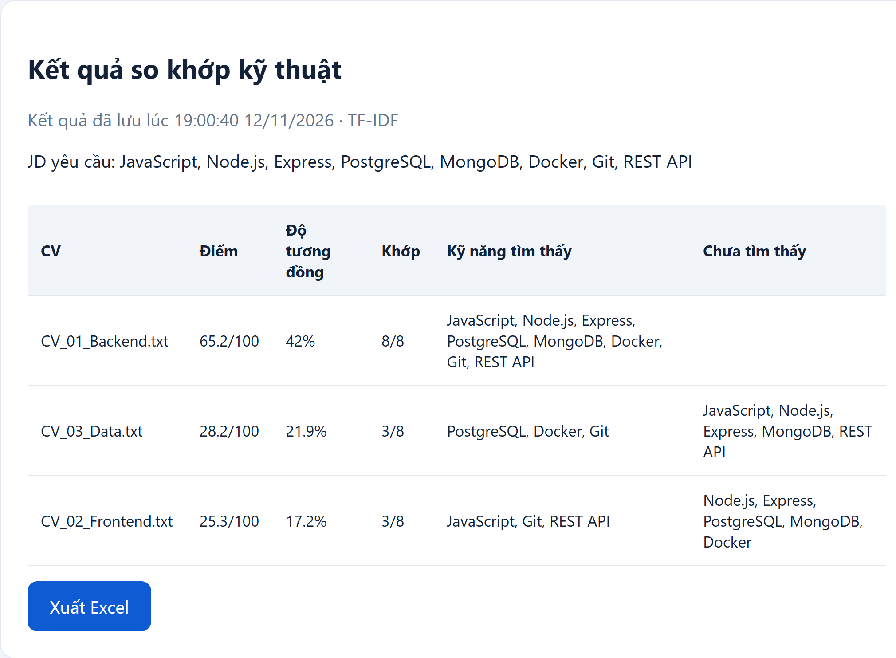
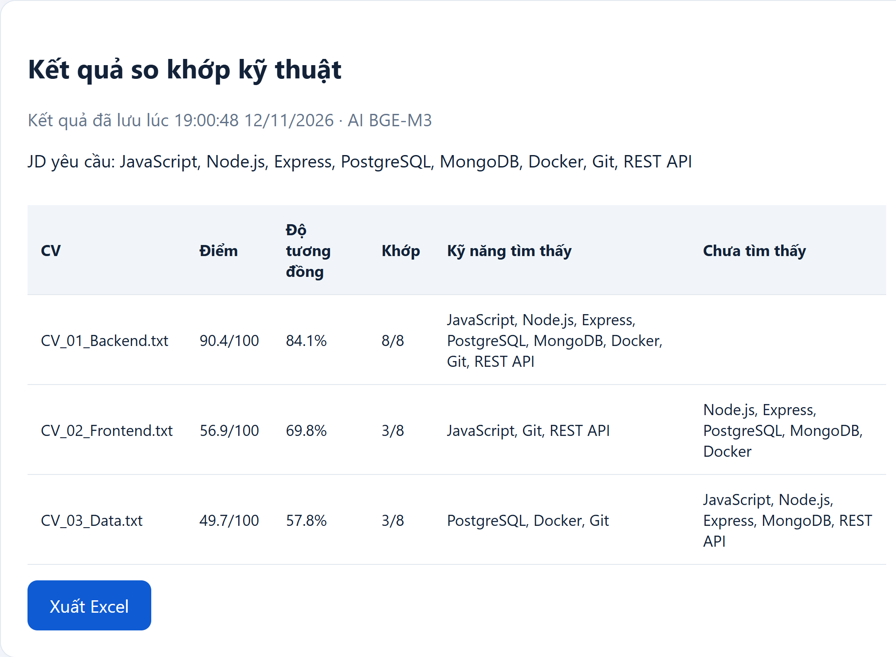
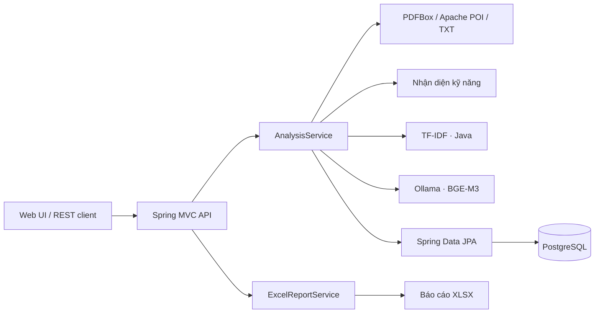

# AI Resume Screening · Spring Boot

[](https://github.com/BuiVoDuyVu/ai-resume-screening-springboot/actions/workflows/ci.yml)

**So khớp CV với mô tả công việc bằng TF-IDF và AI BGE-M3, giải thích kỹ năng khớp, lưu lịch sử và xuất báo cáo Excel.**


Ứng dụng web Java hỗ trợ người tuyển dụng đọc và đối chiếu hồ sơ với yêu cầu kỹ thuật. Có thể chạy ngay chế độ **TF-IDF**; chế độ **AI BGE-M3** sử dụng model chạy cục bộ qua Ollama. Kết quả hiển thị độ tương đồng, kỹ năng đã tìm thấy và kỹ năng chưa thấy trong từng CV.

[Chạy ứng dụng](#chạy-ứng-dụng) · [Kết quả demo](#kết-quả-demo) · [REST API](#rest-api) · [Kiểm thử](#kiểm-thử) · [Báo cáo](#tài-liệu-và-báo-cáo)

## Tính năng

- Phân tích **1–10 CV** mỗi lần, hỗ trợ **PDF có văn bản, DOCX và TXT**, tối đa **5 MB/file**.
- So sánh hai phương pháp trên cùng đầu vào: **TF-IDF + cosine similarity** và **embedding BGE-M3 + cosine similarity**.
- Tách kỹ năng theo từ khóa/alias; trình bày kỹ năng khớp, chưa thấy và điểm kỹ thuật theo công thức rõ ràng.
- Sắp xếp kết quả theo điểm, xuất **Excel (.xlsx)** và mở lại kết quả từ lịch sử.
- Lưu lịch sử bằng **PostgreSQL + Spring Data JPA**, quản lý cấu trúc dữ liệu bằng **Flyway**; dữ liệu còn nguyên sau khi khởi động lại backend.
- Thông báo tiếng Việt cho đầu vào không hợp lệ, PDF cần OCR, lỗi kết nối Ollama và cơ sở dữ liệu.

## Giao diện

**TF-IDF — kết quả với ba CV giả lập**



**AI BGE-M3 — cùng JD và ba CV**



Các ảnh được chụp từ ứng dụng đang chạy. Toàn bộ JD và CV demo trong repository là dữ liệu giả lập.

## Chạy ứng dụng

### Yêu cầu

| Thành phần | Phiên bản / mục đích |
| --- | --- |
| JDK | **25 LTS**, cấu hình `JAVA_HOME` và `PATH` |
| Maven | **3.9+**; `mvn --version` phải nhận Java 25 |
| PostgreSQL | Đã kiểm chứng với **18**; dùng để lưu lịch sử |
| Ollama | Tùy chọn, chỉ cần khi dùng chế độ AI |

### 1. Lấy mã nguồn

```sh
git clone https://github.com/BuiVoDuyVu/ai-resume-screening-springboot.git
cd ai-resume-screening-springboot
java --version
mvn --version
```

### 2. Chuẩn bị PostgreSQL

**Windows, đã cài PostgreSQL 18:** chạy helper từ thư mục repository bằng PowerShell.

```powershell
powershell.exe -NoProfile -ExecutionPolicy Bypass -File .\scripts\Start-LocalPostgres.ps1
```

Helper tạo cụm PostgreSQL riêng tại `127.0.0.1:5433`, database và tài khoản `cv_matching`, sinh mật khẩu ngẫu nhiên rồi ghi cấu hình vào `.env`. Dữ liệu nằm trong `.local/postgres`. Nếu PostgreSQL cài ở vị trí khác, truyền `-PostgresBin` với thư mục công cụ PostgreSQL. Xem [hướng dẫn PostgreSQL](docs/POSTGRESQL.md) để kiểm tra trạng thái hoặc dừng cụm riêng.

**Dùng PostgreSQL có sẵn trên Windows, Linux hoặc macOS:** tạo một database rỗng và tài khoản sở hữu database; sao chép [.env.example](.env.example) thành `.env`, rồi điền `DB_URL`, `DB_USERNAME`, `DB_PASSWORD` theo kết nối của bạn. Ví dụ, đổi cổng trong `DB_URL` sang `5432` nếu instance đang dùng cổng đó. Các giá trị trong `.env` theo định dạng Java properties, không bọc bằng dấu nháy shell. Có thể cấu hình ba biến môi trường cùng tên thay cho file `.env`.

Khi khởi động, Flyway tự tạo năm bảng nghiệp vụ. Không commit `.env` hoặc `.local/`; cả hai đã được bỏ qua trong [.gitignore](.gitignore).

### 3. Khởi động backend

```sh
mvn spring-boot:run
```

Mở **<http://localhost:8080>**. Dán toàn bộ [JD mẫu](demo/job_description.txt), chọn ba file CV trong [demo/](demo/), giữ chế độ **TF-IDF** và nhấn **Phân tích CV**. Kết quả cho phép tải Excel hoặc xem lại từ lịch sử.

Nếu cổng 8080 đang được dùng, chọn cổng 8081:

```sh
mvn spring-boot:run "-Dspring-boot.run.arguments=--server.port=8081"
```

Khi đó giao diện và API cùng dùng **<http://localhost:8081>**. Ảnh minh chứng trong repository được chụp ở cổng 8081.

### 4. Bật AI BGE-M3 (tùy chọn)

Cài và khởi động [Ollama](https://ollama.com/download), sau đó tải model:

```sh
ollama pull bge-m3
ollama list
```

Backend mặc định gọi `http://127.0.0.1:11434/api/embed` với model `bge-m3`. Chọn **AI BGE-M3** trên giao diện và phân tích lại cùng ba CV. Model đã kiểm chứng có dung lượng khoảng 1,16 GB và tạo vector 1.024 chiều. Chế độ TF-IDF không yêu cầu Ollama.

## Kiến trúc



Mỗi lần phân tích lưu JD, metadata CV, kết quả và danh sách kỹ năng vào năm bảng: `job_descriptions`, `cv_documents`, `analyses`, `matching_results`, `matching_skills`. File CV gốc và toàn văn CV không được lưu vào cơ sở dữ liệu.

## Kết quả demo

Đo trên **cùng [JD đầy đủ](demo/job_description.txt)** và ba CV giả lập trong [demo/](demo/), ngày 12/11/2026. Hai phương pháp dùng cùng công thức:

```text
Điểm kỹ thuật = 100 × (0,6 × S + 0,4 × K)
S = cosine similarity được giới hạn trong [0, 1]
K = số kỹ năng khớp / số kỹ năng JD yêu cầu
```

| CV mẫu | Kỹ năng khớp | TF-IDF /100 | BGE-M3 /100 |
| --- | ---: | ---: | ---: |
| Backend | 8/8 | **65,2** | **90,4** |
| Frontend | 3/8 | 25,3 | 56,9 |
| Data | 3/8 | 28,2 | 49,7 |

Điểm AI cao hơn không tự chứng minh chất lượng tốt hơn. Bộ demo ba CV dùng để xác minh luồng xử lý; chưa phải benchmark độ chính xác. Trọng số chưa được hiệu chuẩn, và điểm không phải xác suất phù hợp hoặc quyết định tuyển dụng. Xem [quy trình kiểm chứng AI](docs/AI_VALIDATION.md) và [kết quả kiểm thử](docs/TEST_RESULTS.md).

## REST API

Base URL mặc định: `http://localhost:8080`.

| Phương thức | Endpoint | Chức năng |
| --- | --- | --- |
| `POST` | `/api/analyze` | Phân tích CV bằng `multipart/form-data` |
| `GET` | `/api/export/{analysisId}` | Tải báo cáo Excel của lần phân tích |
| `GET` | `/api/analyses?limit=50` | Liệt kê lịch sử; `limit` từ 1 đến 100 |
| `GET` | `/api/analyses/{analysisId}` | Lấy JD và đầy đủ kết quả đã lưu |
| `DELETE` | `/api/analyses/{analysisId}` | Xóa lần phân tích và dữ liệu liên quan |

Các trường multipart của `POST /api/analyze`:

| Trường | Kiểu | Nội dung |
| --- | --- | --- |
| `jobDescription` | Text | JD, tối đa 10.000 ký tự, có kỹ năng được nhận diện |
| `mode` | Text | `tfidf` hoặc `ai`; mặc định `tfidf` |
| `files` | File | 1–10 CV, lặp lại cùng key `files` |

Nhập [Postman collection](docs/postman/AI-CV-Matching.postman_collection.json) và làm theo [hướng dẫn Postman](docs/postman/README.md). Đặt biến `baseUrl` theo cổng backend đang chạy.

## Kiểm thử

```sh
mvn test
mvn clean package
java -jar target/ai-cv-matching-1.0.0.jar
```

Lần kiểm chứng ngày 12/11/2026: **27/27 test đạt**, không lỗi hoặc bỏ qua; độ bao phủ **289/302 dòng (95,70%)**, **117/142 nhánh (82,39%)**, đo bằng JaCoCo 0.8.14. Bộ kiểm thử bao gồm đọc tài liệu, đầu vào lỗi, TF-IDF, giao tiếp Ollama qua HTTP stub, xuất Excel và giao dịch/lịch sử dữ liệu với H2.

Test tự động không yêu cầu PostgreSQL hoặc model thật. Luồng PostgreSQL 18 và Ollama/BGE-M3 thật đã được kiểm chứng riêng, gồm mở lại lịch sử và xuất Excel sau restart. Số liệu coverage là kết quả của lần đo được ghi trong [báo cáo kiểm thử](docs/TEST_RESULTS.md); lệnh `mvn test` thông thường không tự tạo báo cáo JaCoCo.

## Cấu trúc repository

```text
ai-resume-screening-springboot/
├── .github/workflows/ci.yml               # Java 25 · Maven verify trên GitHub Actions
├── src/main/java/com/example/cvmatching/  # API, phân tích, persistence, Excel
├── src/main/resources/
│   ├── static/                           # Giao diện HTML/CSS/JavaScript
│   ├── db/migration/                     # Flyway SQL
│   └── application.properties
├── src/test/java/                        # Unit và integration test
├── demo/                                 # JD, ba CV giả lập, điểm tham chiếu
├── scripts/                              # Helper PostgreSQL trên Windows
├── docs/
│   ├── images/                           # Ảnh ứng dụng thật
│   ├── postman/                          # Collection và hướng dẫn API
│   └── report/                           # Báo cáo PDF và Word
├── .env.example                          # Mẫu cấu hình, không chứa mật khẩu
├── pom.xml
└── README.md
```

## Tài liệu và báo cáo

- [Hướng dẫn sử dụng](docs/HUONG_DAN.md)
- [PostgreSQL và lịch sử phân tích](docs/POSTGRESQL.md)
- [Kiểm chứng BGE-M3 và so sánh TF-IDF](docs/AI_VALIDATION.md)
- [Kết quả kiểm thử và phạm vi coverage](docs/TEST_RESULTS.md)
- [Postman collection và cách gọi API](docs/postman/README.md)
- Báo cáo đồ án: [PDF](docs/report/Bao_cao_Option2_Java_AI_CV_Matching.pdf) · [Word](docs/report/Bao_cao_Option2_Java_AI_CV_Matching.docx)

## Phạm vi sử dụng

Ứng dụng phục vụ học tập và demo trên máy cá nhân, mặc định chỉ lắng nghe `127.0.0.1`, chưa có đăng nhập/phân quyền hoặc OCR cho PDF scan. Nhận diện kỹ năng bằng từ khóa có thể bỏ sót cách diễn đạt khác; chưa có đánh giá chất lượng AI hoặc công bằng trên tập dữ liệu tuyển dụng thực tế.

JD và tên file vẫn có thể chứa thông tin cá nhân dù không lưu toàn văn CV. Chỉ sử dụng dữ liệu có quyền xử lý, và dùng bộ giả lập đi kèm khi demo công khai. Kết quả hỗ trợ đối chiếu nội dung; người dùng chịu trách nhiệm đánh giá hồ sơ.

---

**Đồ án học phần CS_DATA_17 · Bùi Võ Duy Vũ**
